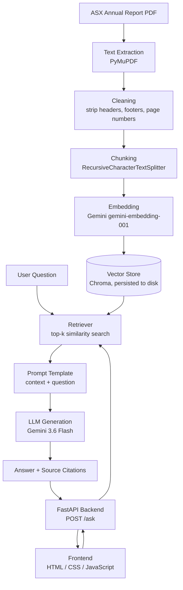

# ASX Annual Report RAG Assistant

A retrieval-augmented generation (RAG) application that answers natural language questions about ASX Limited's FY2025 Annual Report, grounded in the actual document text and cited by page number.

This project was built to demonstrate an end-to-end RAG pipeline over a real, unstructured financial document: PDF extraction, text cleaning, chunking, embedding, vector search, grounded generation, and a working API and frontend.

## What this does

You ask a question in plain English — for example, "What was ASX's operating revenue in FY25?" — and the application:

1. Retrieves the most relevant passages from the 161-page annual report
2. Passes those passages to a language model along with your question
3. Returns an answer generated only from the retrieved content, with the source page numbers cited
4. Refuses to answer if the report doesn't contain the information, rather than guessing

The application has been tested against verified figures from the report (operating revenue, net profit after tax, dividends, earnings per share, capital expenditure) and against adversarial questions designed to test whether it fabricates answers when the correct answer isn't available. Results are documented in the Testing section below.

## Architecture



The pipeline has two distinct phases:

**Indexing (run once, offline):** the PDF is extracted, cleaned, split into chunks, and embedded into a persistent vector store. This only needs to be re-run if the source document changes.

**Querying (run per request):** a user's question is embedded with the same model, matched against the stored chunks, and the most relevant ones are passed to the LLM to generate a grounded answer.

The frontend and backend are deliberately separate: the frontend is a static HTML page that calls the API over HTTP. Either one can be replaced independently without touching the other.

## Tech stack

| Component | Choice | Why |
|---|---|---|
| PDF extraction | PyMuPDF (fitz) | Fast, preserves reading order well for narrative text and simple tables |
| Chunking | LangChain `RecursiveCharacterTextSplitter` | Splits on natural boundaries (paragraphs, sentences) before falling back to hard cuts |
| Embeddings | Google Gemini (`gemini-embedding-001`) | Free tier available, strong retrieval benchmark performance |
| Vector store | Chroma | Local, zero-setup, persists to disk, sufficient for a single-document use case |
| LLM | Google Gemini (`gemini-3.6-flash`) | Fast, cost-efficient, good grounded-answer quality |
| Orchestration | LangChain (LCEL) | Standardizes the retrieval-to-generation chain, makes swapping models straightforward |
| Backend | FastAPI | Async, typed, auto-generates interactive API docs |
| Frontend | Plain HTML, CSS, JavaScript | No build step, full control over styling, calls the API via `fetch` |

## Project structure

```
asx-annual-report-rag-assistant/
├── data/
│   └── asx-2025-annual-report.pdf       (not committed - see Data section)
├── src/
│   ├── extract_pdf.py                   PDF to page-level text
│   ├── clean_text.py                    strips repeated headers/footers/page numbers
│   ├── chunk_text.py                    splits cleaned text into chunks
│   ├── build_vectorstore.py             embeds chunks and persists to Chroma
│   └── rag_chain.py                     retrieval + prompt template + generation chain
├── frontend/
│   └── index.html                       chat interface
├── api.py                               FastAPI app exposing POST /ask
├── build_index.py                       one-time script to build the vector store
├── requirements.txt
└── .gitignore
```

## Setup

### Prerequisites

- Python 3.11+
- A Google Gemini API key (free tier available at [aistudio.google.com](https://aistudio.google.com))

### Installation

```bash
git clone https://github.com/duaasghar/asx-annual-report-rag-assistant.git
cd asx-annual-report-rag-assistant
python -m venv venv
venv\Scripts\activate          # Windows
source venv/bin/activate       # macOS/Linux
pip install -r requirements.txt
```

Create a `.env` file in the project root:

```
GOOGLE_API_KEY=your-api-key-here
```

### Data

The source PDF is not committed to this repository. Download ASX Limited's FY2025 Annual Report from the ASX website and place it at `data/asx-2025-annual-report.pdf`, or point `PDF_PATH` in `src/extract_pdf.py` at a different report of your choice — the pipeline is not specific to this one document.

### Build the index

This step extracts, cleans, chunks, and embeds the report, then persists the result to a local Chroma store. It only needs to be run once (or again if the source document changes).

```bash
python build_index.py
```

Note: the Gemini free tier rate-limits embedding requests. This script batches requests to stay under the per-minute limit, so a full build of roughly 600 chunks takes several minutes. It will not proceed if a populated `chroma_db/` already exists, to avoid creating duplicate entries and wasting API quota.

### Run the API

```bash
uvicorn api:app --reload
```

The API will be available at `http://127.0.0.1:8000`. Interactive documentation is auto-generated at `http://127.0.0.1:8000/docs`.

### Use the frontend

Open `frontend/index.html` directly in a browser. It calls the local API at `http://127.0.0.1:8000/ask`; update the `API_URL` constant in the file if the API is running elsewhere.

## Testing

The application was tested against figures independently verified from the report:

| Question | Expected answer | Result |
|---|---|---|
| Operating revenue in FY25 | $1,107.2 million | Correct, cited pages 5, 12, 13 |
| Total dividend per share for FY25 | 223.3 cents | Correct, cited page 12, broke down interim/final |
| Statutory net profit after tax in FY25 | $502.6 million | Correct, cited pages 12, 13 |
| Basic earnings per share in FY25 | 259.1 cents | Correct, distinguished from underlying EPS (262.9 cents) |
| Capital expenditure in FY25 | $176.0 million | Correct, broken into components ($77.7m, $98.3m) |

It was also tested against two adversarial questions designed to check for hallucination:

- Asked for the CEO's salary in a currency not used in the report: correctly stated it did not have enough information, rather than guessing a conversion.
- Asked for revenue in a year beyond the report's coverage (FY30): correctly refused rather than extrapolating.

## Design decisions and known limitations

**Chunking is done per page, not across page boundaries.** This keeps page-level citation simple and accurate, but a table or paragraph that spans two pages could be split across chunks. A future improvement would merge adjacent pages before chunking when a table is detected crossing a page break.

**Table extraction relies on PyMuPDF's default text extraction rather than a dedicated table parser.** This was tested directly against known figures in multi-column tables (for example, the intangible assets breakdown on page 116) and produced correct results for this document. This is not guaranteed for every PDF; a document with a more complex or image-based table layout may need `pdfplumber`'s dedicated table extraction instead.

**The retrieval and source-citation steps currently run as two separate calls** (one through the full chain, one direct to the retriever) rather than a single pass that exposes both. This is simpler to read but does slightly more work than necessary; restructuring the chain to expose intermediate retrieval results would remove the duplication.

**The vector store is local (Chroma, file-based)**, which is appropriate for a single-document, single-user project but would not scale to concurrent users or a larger document corpus without moving to a hosted vector database.

## Possible extensions

- Hybrid search (combining semantic and keyword search) to better handle exact figures and product/entity names
- Reranking retrieved chunks with a cross-encoder before generation
- Multi-document support, to compare figures across multiple companies or years
- Automated evaluation of faithfulness and answer relevance using a framework such as Ragas
