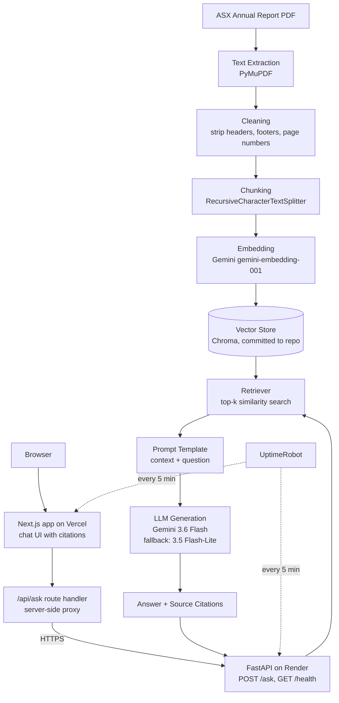

# ASX Annual Report RAG Assistant

[](https://github.com/duaasghar/asx-annual-report-rag-assistant/actions/workflows/ci.yml)

**Live demo:** https://asx-annual-report-rag-assistant.vercel.app
**Status page:** https://stats.uptimerobot.com/lH9Opyiuyz
**API docs:** https://asx-rag-api.onrender.com/docs

**Stack:** Next.js + TypeScript (Vercel) → FastAPI (Render) → LangChain + Chroma + Gemini

A retrieval-augmented generation (RAG) application that answers natural language questions about ASX Limited's FY2025 Annual Report, grounded in the actual document text and cited by page number.

This project was built to demonstrate an end-to-end RAG pipeline over a real, unstructured financial document: PDF extraction, text cleaning, chunking, embedding, vector search, grounded generation, and a deployed, monitored API and frontend.

> The API runs on Render's free tier, which sleeps after inactivity. If the first question takes ~30 seconds, the server is waking up.

## What this does

You ask a question in plain English — for example, "What was ASX's operating revenue in FY25?" — and the application:

1. Retrieves the most relevant passages from the 161-page annual report
2. Passes those passages to a language model along with your question
3. Returns an answer generated only from the retrieved content, with the source page numbers cited
4. Refuses to answer if the report doesn't contain the information, rather than guessing

The application has been tested against verified figures from the report (operating revenue, net profit after tax, dividends, earnings per share, capital expenditure) and against adversarial questions designed to test whether it fabricates answers when the correct answer isn't available. Results are documented in the Testing section below.

## Architecture



The pipeline has two distinct phases:

**Indexing (run once, offline):** the PDF is extracted, cleaned, split into chunks, and embedded into a persistent vector store. The resulting `chroma_db/` (619 chunks) is committed, so the deployed API serves answers without needing the PDF. This only needs to be re-run if the source document changes.

**Querying (run per request):** the browser calls the Next.js `/api/ask` route, which validates the question and forwards it server-side to the FastAPI backend. The question is embedded with the same model, matched against the stored chunks, and the most relevant ones are passed to the LLM to generate a grounded answer.

## Security and reliability

- **Server-side proxy:** the browser only talks to the Next.js app. The backend URL lives in a server-side env var and is never sent to the client.
- **Input validation in two places:** the proxy and the API both reject empty or over-500-character questions.
- **CORS restricted** to the Vercel frontend and `localhost:3000` via the `ALLOWED_ORIGINS` env var.
- **Rate limiting** with `slowapi`: 10 requests/minute per IP and 60/minute globally on `/ask`, protecting the Gemini quota.
- **Secrets in env vars only:** `GOOGLE_API_KEY` on Render, `BACKEND_URL` on Vercel. Nothing sensitive is committed.
- **Fail fast with a fallback model:** each Gemini call times out after 20 seconds, falls back from `gemini-3.6-flash` to `gemini-3.5-flash-lite`, and returns a clean 503 if both are unavailable, so users get a clear message instead of a hang.
- **Typed end to end:** Pydantic response models in the API, matching TypeScript types plus a runtime shape check in the frontend.

## Monitoring and CI

- **UptimeRobot** checks the Vercel site and the API's `/health` endpoint every 5 minutes, published on a [public status page](https://stats.uptimerobot.com/lH9Opyiuyz). `/health` reports the number of indexed chunks and returns `degraded` if the index is empty. The regular checks also keep the free Render instance warm.
- **GitHub Actions** runs on every push and pull request: frontend lint, type generation, `tsc --noEmit` and production build, plus backend `pytest` smoke tests (health, HEAD support, validation, CORS, response shape and the 503 path) that run without calling Gemini.
- **Logs:** Vercel function logs for the proxy and Render logs for the API. Gemini failures are logged with full tracebacks.

## Tech stack

| Component | Choice | Why |
|---|---|---|
| PDF extraction | PyMuPDF (fitz) | Fast, preserves reading order well for narrative text and simple tables |
| Chunking | LangChain `RecursiveCharacterTextSplitter` | Splits on natural boundaries (paragraphs, sentences) before falling back to hard cuts |
| Embeddings | Google Gemini (`gemini-embedding-001`) | Free tier available, strong retrieval benchmark performance |
| Vector store | Chroma | Local, zero-setup, persists to disk, sufficient for a single-document use case |
| LLM | Google Gemini (`gemini-3.6-flash`, fallback `gemini-3.5-flash-lite`) | Fast, cost-efficient, good grounded-answer quality; fallback keeps the demo up during demand spikes |
| Orchestration | LangChain (LCEL) | Standardises the retrieval-to-generation chain, makes swapping models straightforward |
| Backend | FastAPI + slowapi, hosted on Render | Typed, auto-generates interactive API docs; rate limiting in a few lines |
| Frontend | Next.js (App Router) + TypeScript + Tailwind, hosted on Vercel | Server-side route handler for the proxy, typed UI, zero-config deploys |
| Monitoring / CI | UptimeRobot, GitHub Actions | Free uptime checks with a public status page; every push is linted, type-checked, built and tested |

## Project structure

```
asx-annual-report-rag-assistant/
├── .github/workflows/ci.yml             CI: frontend build checks + backend tests
├── chroma_db/                           persisted vector index (619 chunks)
├── data/
│   └── asx-2025-annual-report.pdf       (not committed - see Data section)
├── src/
│   ├── extract_pdf.py                   PDF to page-level text
│   ├── clean_text.py                    strips repeated headers/footers/page numbers
│   ├── chunk_text.py                    splits cleaned text into chunks
│   ├── build_vectorstore.py             embeds chunks and persists to Chroma
│   └── rag_chain.py                     retrieval + prompt template + generation chain
├── tests/
│   └── test_api.py                      API smoke tests (no Gemini calls)
├── web/                                 Next.js frontend (deployed to Vercel)
│   ├── app/page.tsx                     chat UI with citations
│   ├── app/api/ask/route.ts             server-side proxy to the API
│   └── lib/types.ts                     shared response types
├── api.py                               FastAPI app: POST /ask, GET /health
├── build_index.py                       one-time script to build the vector store
├── requirements.txt                     runtime dependencies
└── requirements-dev.txt                 adds pytest
```

## Setup

### Prerequisites

- Python 3.11+
- Node.js 20+ (for the frontend)
- A Google Gemini API key (free tier available at [aistudio.google.com](https://aistudio.google.com))

### Backend

```bash
git clone https://github.com/duaasghar/asx-annual-report-rag-assistant.git
cd asx-annual-report-rag-assistant
python -m venv venv
venv\Scripts\activate          # Windows
source venv/bin/activate       # macOS/Linux
pip install -r requirements-dev.txt
```

Create a `.env` file in the project root:

```
GOOGLE_API_KEY=your-api-key-here
ALLOWED_ORIGINS=http://localhost:3000
```

Run the API and the tests:

```bash
uvicorn api:app --reload
python -m pytest -q tests
```

The API will be available at `http://127.0.0.1:8000`, with interactive docs at `http://127.0.0.1:8000/docs`.

### Frontend

```bash
cd web
cp .env.example .env.local     # then set BACKEND_URL, e.g. http://127.0.0.1:8000
npm install
npm run dev
```

Open http://localhost:3000.

### Data

The source PDF is not committed to this repository, but the built index in `chroma_db/` is, so the app works without it. To rebuild the index, download ASX Limited's FY2025 Annual Report from the ASX website and place it at `data/asx-2025-annual-report.pdf`, or point `PDF_PATH` in `src/extract_pdf.py` at a different report of your choice — the pipeline is not specific to this one document.

### Rebuild the index

This step extracts, cleans, chunks, and embeds the report, then persists the result to a local Chroma store.

```bash
python build_index.py
```

Note: the Gemini free tier rate-limits embedding requests. This script batches requests to stay under the per-minute limit, so a full build of roughly 600 chunks takes several minutes. It will ask for confirmation if a populated `chroma_db/` already exists, to avoid wasting API quota.

### Deployment

- **API (Render web service):** build `pip install -r requirements.txt`, start `uvicorn api:app --host 0.0.0.0 --port $PORT --proxy-headers --forwarded-allow-ips "*"`, health check `/health`, env vars `GOOGLE_API_KEY` and `ALLOWED_ORIGINS`.
- **Frontend (Vercel):** root directory `web`, env var `BACKEND_URL`.

## Testing

The application was tested against figures independently verified from the report:

| Question | Expected answer | Result |
|---|---|---|
| Operating revenue in FY25 | $1,107.2 million | Correct, cited pages 5, 12, 13 |
| Total dividend per share for FY25 | 223.3 cents | Correct, cited page 12, broke down interim/final |
| Statutory net profit after tax in FY25 | $502.6 million | Correct, cited pages 12, 13 |
| Basic earnings per share in FY25 | 259.1 cents | Correct, distinguished from underlying EPS (262.9 cents) |
| Capital expenditure in FY25 | $176.0 million | Correct, broken into components ($77.7m, $98.3m) |

It was also tested against two adversarial questions designed to check for hallucination:

- Asked for the CEO's salary in a currency not used in the report: correctly stated it did not have enough information, rather than guessing a conversion.
- Asked for revenue in a year beyond the report's coverage (FY30): correctly refused rather than extrapolating.

## Design decisions and known limitations

**Chunking is done per page, not across page boundaries.** This keeps page-level citation simple and accurate, but a table or paragraph that spans two pages could be split across chunks. A future improvement would merge adjacent pages before chunking when a table is detected crossing a page break.

**Table extraction relies on PyMuPDF's default text extraction rather than a dedicated table parser.** This was tested directly against known figures in multi-column tables (for example, the intangible assets breakdown on page 116) and produced correct results for this document. This is not guaranteed for every PDF; a document with a more complex or image-based table layout may need `pdfplumber`'s dedicated table extraction instead.

**The retrieval and source-citation steps currently run as two separate calls** (one through the full chain, one direct to the retriever) rather than a single pass that exposes both. This is simpler to read but does slightly more work than necessary; restructuring the chain to expose intermediate retrieval results would remove the duplication.

**The vector store is local (Chroma, file-based) and shipped with the app.** This is appropriate for a single-document project but would not scale to a larger or frequently changing corpus without moving to a hosted vector database.

**Free-tier hosting.** Render's free instance sleeps after inactivity (mitigated by the 5-minute uptime checks) and the Gemini free tier can hit quota or demand limits (mitigated by the fallback model and fail-fast timeouts). Rate limiting is in-memory, so limits reset on restart and would need a shared store such as Redis to work across multiple instances.

## Possible extensions

- Hybrid search (combining semantic and keyword search) to better handle exact figures and product/entity names
- Reranking retrieved chunks with a cross-encoder before generation
- Multi-document support, to compare figures across multiple companies or years
- Automated evaluation of faithfulness and answer relevance using a framework such as Ragas
- Streaming answers to the UI as they are generated
